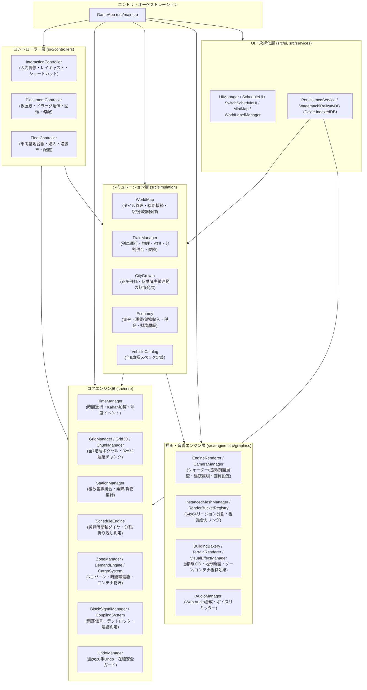

# わがまちレールウェイ 現行システム仕様書

## 1. プロジェクト概要

**わがまちレールウェイ（`wagamachi-railway`）** は、Three.js (WebGL) と TypeScript を用いて構築された、ブラウザ完結型の **3D鉄道経営・都市開発箱庭シミュレーションゲーム** です。PC（マウス＆キーボード）およびスマートフォン・タブレット（タッチ＆画面中央ターゲットレティクル）のマルチデバイス操作に対応しています。

### 1.1 技術スタック
| カテゴリ | 使用技術・バージョン | 用途 |
| :--- | :--- | :--- |
| 言語 / ビルド | TypeScript `^5.3.3` / Vite `^5.0.12` | モジュールバンドル・型安全開発 |
| 3Dグラフィックス | Three.js `^0.160.0` | WebGL 3D描画・PBRライティング・シャドウ・InstancedMesh |
| データ永続化 | Dexie.js `^4.4.6` (IndexedDB) + `localStorage` | 大規模マップ・列車・財務・システム設定の非同期トランザクション保存 |
| サウンド | Web Audio API | 完全プロシージャル音源合成（外部音声ファイル不要） |
| E2Eテスト | Playwright `^1.63.0` | シナリオ別自動ブラウザ検証 |

---

## 2. システムアーキテクチャ

アプリケーションは [`GameApp`](file:///d:/development/わがまちレールウェイ/src/main.ts#L38-L761) を Facade とし、**Core（基盤・ルール）**、**Simulation（ワールド・列車・経済・都市発展）**、**Controllers（操作・配置・編成管理）**、**Engine / Graphics（3D描画・音響・最適化）**、**UI（HUD・モーダル・ダイヤエディタ・ミニマップ）**、**Services（IndexedDB永続化）** の6層に責務分割されています。



### 2.1 ディレクトリ・主要モジュール一覧
- **エントリ**: [`src/main.ts`](file:///d:/development/わがまちレールウェイ/src/main.ts)
- **コントローラー (`src/controllers/`)**:
  - [`InteractionController.ts`](file:///d:/development/わがまちレールウェイ/src/controllers/InteractionController.ts): ポインター・タッチ・キーボード入力調停、レイキャスト、撤去ディスパッチ
  - [`PlacementController.ts`](file:///d:/development/わがまちレールウェイ/src/controllers/PlacementController.ts): 建設ツールの仮置き（Pending）、ドラッグ一括敷設、ホバーガイド、踏切・勾配判定
  - [`FleetController.ts`](file:///d:/development/わがまちレールウェイ/src/controllers/FleetController.ts): 車両基地（FleetRegistry）管理、車両購入・増減車・売却・線路への配置と回送
- **コア (`src/core/`)**:
  - [`constants.ts`](file:///d:/development/わがまちレールウェイ/src/core/constants.ts) / [`types.ts`](file:///d:/development/わがまちレールウェイ/src/core/types.ts): 定数・型定義
  - [`GameState.ts`](file:///d:/development/わがまちレールウェイ/src/core/GameState.ts): ゲームフェーズ（`title` / `playing` / `paused`）と初期設定
  - [`Grid3D.ts`](file:///d:/development/わがまちレールウェイ/src/core/Grid3D.ts) / [`GridManager.ts`](file:///d:/development/わがまちレールウェイ/src/core/GridManager.ts) / [`ChunkManager.ts`](file:///d:/development/わがまちレールウェイ/src/core/ChunkManager.ts): 全7階層3D座標系、地形生成、32×32チャンク遅延生成・可視カリング
  - [`TimeManager.ts`](file:///d:/development/わがまちレールウェイ/src/core/TimeManager.ts): カレンダー・時刻進行、Kahan加算による丸め誤差補正、速度倍率（0〜5）
  - [`StationManager.ts`](file:///d:/development/わがまちレールウェイ/src/core/StationManager.ts): 駅・複数ホーム（番線）の自動統合、駅名変更、有効長変更、維持費・乗降実績管理
  - [`ScheduleEngine.ts`](file:///d:/development/わがまちレールウェイ/src/core/ScheduleEngine.ts): 駅到着時の動作解決、停車中のリアルタイム発車判定（ピン時刻・パターンダイヤ・停車時間・通過）
  - [`ZoneManager.ts`](file:///d:/development/わがまちレールウェイ/src/core/ZoneManager.ts) / [`DemandEngine.ts`](file:///d:/development/わがまちレールウェイ/src/core/DemandEngine.ts) / [`CargoSystem.ts`](file:///d:/development/わがまちレールウェイ/src/core/CargoSystem.ts): RCIゾーニング（空間バケットインデックス）、時間帯別乗客需要、貨物生産・輸送・商業魅力度連動
  - [`BlockSignal.ts`](file:///d:/development/わがまちレールウェイ/src/core/BlockSignal.ts) / [`CouplingSystem.ts`](file:///d:/development/わがまちレールウェイ/src/core/CouplingSystem.ts): 閉塞信号制御、最大10両編成の全マス在線ロック、デッドロック（10分以上停止）検知、連結可否判定
  - [`TrackBuilder.ts`](file:///d:/development/わがまちレールウェイ/src/core/TrackBuilder.ts): ドラッグ始点〜終点の直線・L字カーブ自動補間
  - [`UndoManager.ts`](file:///d:/development/わがまちレールウェイ/src/core/UndoManager.ts): 敷設・撤去操作の履歴管理（最大20件）と列車在線時の安全ガード付き巻き戻し
- **シミュレーション (`src/simulation/`)**:
  - [`WorldMap.ts`](file:///d:/development/わがまちレールウェイ/src/simulation/WorldMap.ts): 3Dタイルマップ、線路接続・分岐・シーサスクロッシング・4マス勾配・駅設置ロジック
  - [`TrainManager.ts`](file:///d:/development/わがまちレールウェイ/src/simulation/TrainManager.ts) およびサブシステム ([`TrainKinematics.ts`](file:///d:/development/わがまちレールウェイ/src/simulation/trains/TrainKinematics.ts), [`TrainCollisionSystem.ts`](file:///d:/development/わがまちレールウェイ/src/simulation/trains/TrainCollisionSystem.ts), [`TrainCouplingManager.ts`](file:///d:/development/わがまちレールウェイ/src/simulation/trains/TrainCouplingManager.ts), [`TrainPayloadSystem.ts`](file:///d:/development/わがまちレールウェイ/src/simulation/trains/TrainPayloadSystem.ts)): 列車走行・曲線/カント/勾配姿勢制御、ATS衝突回避、編成の分割・併合、旅客乗降・貨物積卸
  - [`CityGrowth.ts`](file:///d:/development/わがまちレールウェイ/src/simulation/CityGrowth.ts): 毎日12:00（正午）の駅周辺自動発展ロジック
  - [`Economy.ts`](file:///d:/development/わがまちレールウェイ/src/simulation/Economy.ts): 資金・収支管理、年度末税額確定（3/31）・納税執行（5/30）、月次（24ヶ月）・年次（10年）スナップショット
  - [`VehicleCatalog.ts`](file:///d:/development/わがまちレールウェイ/src/simulation/VehicleCatalog.ts): 6車種の性能・価格・運賃・運行費・カラー定義
- **描画・音響 (`src/engine/`, `src/graphics/`, `src/models/`)**:
  - [`Renderer.ts`](file:///d:/development/わがまちレールウェイ/src/engine/Renderer.ts): シーン、ライト、ソフトシャドウ、地面ステンシル開口部（地下スロープ掘割）、昼夜連続ライティング、画質設定（`high` / `medium` / `low`）
  - [`AudioManager.ts`](file:///d:/development/わがまちレールウェイ/src/engine/AudioManager.ts): ジョイント音、警笛、発車ベル、踏切警報音、連結・解放音、前面展望モーター音の合成と同時発音数制限
  - [`CameraManager.ts`](file:///d:/development/わがまちレールウェイ/src/graphics/CameraManager.ts): クォータービュー（平行投影・90度ステップ回転）、追跡カメラ（Chase View）、前面展望カメラ（Cab View）、X-Ray半透明透過
  - [`InstancedMeshManager.ts`](file:///d:/development/わがまちレールウェイ/src/graphics/InstancedMeshManager.ts) / [`RenderBucketRegistry.ts`](file:///d:/development/わがまちレールウェイ/src/graphics/RenderBucketRegistry.ts): 大量オブジェクトのGPUインスタンシングと64×64リージョン別視錐台カリング
  - [`ModelFactory.ts`](file:///d:/development/わがまちレールウェイ/src/models/ModelFactory.ts) および各メッシュビルダー (`TrackMeshBuilder`, `StationMeshBuilder`, `StructureMeshBuilder`, `BuildingBakery`, `VehicleMeshBuilder`)
- **UI・サービス (`src/ui/`, `src/services/`)**:
  - [`UIManager.ts`](file:///d:/development/わがまちレールウェイ/src/ui/UIManager.ts), [`ScheduleUI.ts`](file:///d:/development/わがまちレールウェイ/src/ui/ScheduleUI.ts), [`SwitchScheduleUI.ts`](file:///d:/development/わがまちレールウェイ/src/ui/SwitchScheduleUI.ts), [`MiniMap.ts`](file:///d:/development/わがまちレールウェイ/src/ui/MiniMap.ts), [`WorldLabelManager.ts`](file:///d:/development/わがまちレールウェイ/src/ui/WorldLabelManager.ts)
  - [`Database.ts`](file:///d:/development/わがまちレールウェイ/src/services/Database.ts), [`PersistenceService.ts`](file:///d:/development/わがまちレールウェイ/src/services/PersistenceService.ts)

---

## 3. ワールド・3次元グリッド・地形仕様

### 3.1 マップサイズとチャンク構造
- **マップサイズ (`MapSize`)**: `64` / `128` / `256` / `512` / `1024` マス四方から新規ゲーム開始時に選択可能（デフォルト `256`）。
- **1マスのサイズ**: `2.0` ワールド単位（鉄道延長換算では `1マス = 0.1 km`）。
- **チャンク分割 (`CHUNK_SIZE = 32`)**: 32×32マス単位でチャンク管理。広大マップ（512 / 1024）でも起動時のフリーズを防ぐため、カメラ可視範囲に入ったチャンクや建設・地形参照されたチャンクのみをオンデマンド遅延生成（`ensureChunk`）します。

### 3.2 立体7階層（`GridLayer`）と高さ定義
全7階層の立体グリッド構造（1階層あたり高さ `3.0` ワールド単位）を持ちます（[`Grid3D.ts`](file:///d:/development/わがまちレールウェイ/src/core/Grid3D.ts#L14-L78)）。

| 階層値 (`GridLayer`) | 表示名 | 短縮名 | 基準Y高さ | 属性 | 主な用途 |
| :---: | :--- | :---: | :---: | :--- | :--- |
| `5` | 地上5F (展望高架) | `5F` | `+12.0` | 高架 (`isElevated`) | 超高層高架線路・高架駅 |
| `4` | 地上4F (4段目高架) | `4F` | `+9.0` | 高架 (`isElevated`) | 高層高架線路・山岳越え |
| `3` | 地上3F (3段目高架) | `3F` | `+6.0` | 高架 (`isElevated`) | 立体交差高架 |
| `2` | 地上2F (標準高架・鉄橋) | `2F` | `+3.0` | 高架 (`isElevated`) | 標準高架線路・高架駅・河川橋梁 |
| `1` | 地上1F (地表) | `1F` | `0.0` (+標高オフセット) | 地表 (`isGround`) | 地上線路・駅・道路・踏切・建物・ゾーニング |
| `-1` | 地下B1F (地下鉄) | `B1` | `-3.0` | 地下 (`isUnderground`) | 浅層地下鉄トンネル・地下駅 |
| `-2` | 地下B2F (深層地下鉄) | `B2` | `-6.0` | 地下 (`isUnderground`) | 深層地下鉄トンネル・地下立体交差 |

- **階層スライサー表示**:
  - `All`（全体表示）: 地上階層（`1F`〜`5F`）をすべて通常マテリアルで表示。
  - 個別階層選択時（`5F`〜`B2`）: 選択中の階層を不透明で強調表示し、それ以外の階層は半透明ゴースト（不透明度 `0.28`）で表示。地下階層（`B1` / `B2`）選択時は地表メッシュを非表示にし、地下専用作業フロアを表示。
  - 山岳の内部（`layer < surfaceElevation`）に敷設された線路は自動的に **トンネル区間** として判定され、地形断面にトンネルポータル（坑口）が描画されます。

### 3.3 地形テンプレート (`TerrainType`)
新規ゲーム開始時に以下の4種類から選択可能です（いずれのテンプレートも中央の初期都市エリア `|x| <= 9, |z| <= 5` は標高1の平地として保護されます）。
1. **`flat`（完全平地）**: 全域が標高1の平地で水域なし。
2. **`balanced`（山海平野バランス型）**: 中央平野の南側（`Z=8〜10`付近）に蛇行する河川、周辺部（距離18超）に標高2〜3の丘陵を配置。
3. **`mountain`（山岳地帯）**: 中央の谷間平野を囲むように標高2〜5の急峻な山岳が連なる地形。トンネルや勾配線路の活用が求められる。
4. **`coastal`（臨海・海岸線）**: 西側（`X < -10`付近）に広大な海が広がり、東側内陸部（`X > 20`）に標高2の台地がある臨海地形。

---

## 4. 建設・インフラ・撤去・Undo仕様

### 4.1 建設ツール一覧とコスト（`TOOL_CONFIG`）
画面下部のツールバーは **5つのカテゴリー**（線路・駅・街づくり・ゾーニング・列車）に整理されています（[`UIManager.ts`](file:///d:/development/わがまちレールウェイ/src/ui/UIManager.ts#L50-L136)）。

| カテゴリ | ツールID (`ActiveTool`) | 名称 | 建設/実行コスト | 仕様・備考 |
| :--- | :--- | :--- | :---: | :--- |
| **基本** | `select` | 選択 | ¥0 | 列車・駅・分岐器・タイル情報のインスペクター表示 |
| **線路** | `rail-straight` | 直線線路 | ¥500,000 / マス | 地上1Fはバラスト軌道、2F以上は高架(`rail-elevated`: ¥1,500,000)、山岳内/地下はトンネル(`rail-tunnel`: ¥1,200,000)へ自動解決。ドラッグ一括敷設対応 |
| **線路** | `level-crossing` | 踏切 | ¥800,000 / マス | 地上1F専用。警報機・遮断機付き（既存の道路と直進レールを直交敷設した場合も自動で踏切化） |
| **線路** | `rail-curve` | 曲線線路 | ¥800,000 / マス | 4方向（`N_E`, `E_S`, `S_W`, `W_N`）。高架階層では高架曲線(`rail-curve-elevated`: ¥2,400,000)へ自動解決 |
| **線路** | `rail-slope` | 勾配線路 | ¥1,500,000 / 組 | **連続4マス直線**で現在の階層から1つ上の階層（`layer` ➔ `layer + 1`）へ接続 |
| **線路** | `rail-slope-underground` | 地下勾配線路 | ¥2,000,000 / 組 | **連続4マス直線**で現在の階層から1つ下の階層（地上1F ➔ 地下B1F 等）へ接続。地表にステンシル開口部を生成 |
| **線路** | `point-switch` | 分岐器 | ¥1,000,000 / マス | 1×1マス単線分岐器。右分岐/左分岐切替可能。高架時は ¥2,000,000 |
| **線路** | `scissors-crossing` | シーサスクロッシング | ¥3,000,000 / 組 | **2×2マス（4マス占有）** の複線両渡り線。高架時は ¥5,000,000 |
| **駅** | `station-small` | 駅（旅客駅） | ¥8,000,000 / マス | ホーム有効長 1〜10両（建設時は有効長×単価）。高架階層では高架駅(`station-elevated`: ¥18,000,000/マス)へ自動解決 |
| **駅** | `signal-yard` | 信号場・留置線 | ¥2,000,000 / マス | 乗降を行わない運転停車・待避・折り返し・夜間留置用の設備 |
| **駅** | `cargo-station` | 貨物駅 | ¥6,000,000 / マス | コンテナヤード併設ホーム。貨物列車のコンテナ積載・荷降ろし拠点 |
| **街づくり** | `road` | 道路 | ¥300,000 / マス | ドラッグ一括敷設対応。地上線路と直交すると自動で踏切化。周辺の都市発展確率を向上 |
| **街づくり** | `building-res` | 住宅区画 | ¥4,000,000 / マス | 住宅（Lv.1）を即時建設 |
| **街づくり** | `building-com` | 商業ビル | ¥12,000,000 / マス | 商業ビル（Lv.1）を即時建設 |
| **街づくり** | `building-ind` | 工業施設 | ¥8,000,000 / マス | 工場（Lv.1）を即時建設（毎日17:00にコンテナを生産） |
| **街づくり** | `nature` | 植林 | ¥200,000 / マス | 街路樹・緑地を配置 |
| **ゾーニング** | `zone-residential` | 住宅ゾーン | ¥100,000 / 回 | 半径2マスの円形ブラシで住宅区画を指定 |
| **ゾーニング** | `zone-commercial` | 商業ゾーン | ¥100,000 / 回 | 半径2マスの円形ブラシで商業区画を指定 |
| **ゾーニング** | `zone-industrial` | 工業ゾーン | ¥100,000 / 回 | 半径2マスの円形ブラシで工業区画を指定 |
| **ゾーニング** | `zone-clear` | ゾーン解除 | ¥0 | 半径2マスの円形ブラシでゾーン指定を解除 |
| **撤去** | `demolish-track` | 線路撤去 | ¥200,000 | 線路・分岐器・シーサス・勾配・踏切のみを撤去（誤爆防止のスコープ制限付き） |
| **撤去** | `demolish-station` | 駅撤去 | ¥200,000 | 駅・信号場・貨物駅のみを撤去（ホーム全体を撤去し通常の直線線路へ戻す） |
| **撤去** | `demolish-city` | 構造物撤去 | ¥200,000 | 道路・住宅・商業ビル・工業施設・植林・踏切を撤去 |
| **撤去** | `demolish-train` | 列車撤去 | ¥0 | クリックした走行中列車を路線から撤去し、車両基地（`in_depot`）へ回収 |

### 4.2 仮置き（Pending）とドラッグ一括敷設
- **仮置き確認フロー**: 線路・駅・建物等の配置時は即座に確定せず、半透明ゴーストとして仮置き（`pendingItems`）され、画面上の「決定（または `Enter` キー）」で一括決済・建設、「キャンセル（または `Esc` キー）」で破棄されます。
- **ドラッグ線路延伸 ([`TrackBuilder`](file:///d:/development/わがまちレールウェイ/src/core/TrackBuilder.ts))**: 直線線路や道路ツールでドラッグすると、始点から終点までの直線または **L字型（直線＋角の曲線線路＋直線）** の経路を自動計算してプレビューします。
- **複数番線の自動統合 ([`StationManager`](file:///d:/development/わがまちレールウェイ/src/core/StationManager.ts#L116-L255))**: 既存の駅と同種別・同階層・同軌道軸で、距離2マス以内に平行してホームを新設すると、自動的に同一駅の「2番線、3番線…」として統合されます。

### 4.3 Undo（元に戻す）機能（[`UndoManager`](file:///d:/development/わがまちレールウェイ/src/core/UndoManager.ts)）
- **最大履歴数**: 直近 `20` 件（`MAX_HISTORY = 20`）の建設（`placement`）および撤去（`demolition`）アクションを保持。
- **実行方法**: HUDの「元に戻す」ボタン、または `Ctrl + Z`（Mac: `Cmd + Z`）。※テキスト入力フィールド（`<input>`, `<textarea>`）にフォーカスがある場合は誤発動を防止。
- **安全ガード**: 設置した線路や駅のUndo時、そのタイル上に現在列車が走行・停車中（在線中）である場合は、脱線防止のためUndoを拒否してエラートーストを表示し、履歴スタックを保持します。
- **全額返金**: Undo成功時は、建設費または撤去費用が営業収入とは別枠の純粋返金（`economy.refundFunds`）として全額キャッシュバックされます（法人税の課税対象外）。

---

## 5. 鉄道車両・運行・物理・ダイヤ仕様

### 5.1 車両カタログ（[`VehicleCatalog.ts`](file:///d:/development/わがまちレールウェイ/src/simulation/VehicleCatalog.ts)）
編成両数は **1両〜最大10両 (`MAX_TRAIN_CARS = 10`)** まで編成可能です。車両基地モーダルから購入・増減車（減車・売却時は購入価格の50%返金）・路線への配置・車庫への回送を行えます。

| 車種ID | 名称 | カテゴリ | 速度 (マス/分) | 最高速度 | 1両購入価格 | 1両定員 (最大乗車率) | 1両最大乗客 | 運賃 (1人) | 区間運行費 (1両/発着) | 日次維持費 (1両/日) |
| :--- | :--- | :---: | :---: | :---: | :---: | :---: | :---: | :---: | :---: | :---: |
| `freight-train` | 貨物列車 (EF級) | `freight` | `1.0` | 75 km/h | ¥15,000,000 | 0人 (貨物専用) | 0人※ | ¥0※ | ¥1,000 | ¥3,000 |
| `commuter-train` | 通勤型列車 | `commuter` | `1.5` | 95 km/h | ¥12,000,000 | 150人 (200%) | 300人 | ¥250 | ¥1,500 | ¥4,000 |
| `suburban-train` | 近郊型列車 | `suburban` | `2.0` | 110 km/h | ¥18,000,000 | 120人 (175%) | 210人 | ¥350 | ¥2,200 | ¥6,000 |
| `rapid-train` | 快速用列車 | `rapid` | `2.0` | 125 km/h | ¥25,000,000 | 100人 (175%) | 175人 | ¥500 | ¥3,000 | ¥8,000 |
| `express-train` | 急行型列車 | `express` | `2.5` | 135 km/h | ¥40,000,000 | 80人 (150%) | 120人 | ¥800 | ¥4,500 | ¥12,000 |
| `limited-express-train` | 特急型列車 | `limited-express` | `3.0` | 160 km/h | ¥60,000,000 | 60人 (125%) | 75人 | ¥1,400 | ¥7,000 | ¥18,000 |

> [!NOTE]
> 貨物列車（`freight-train`）のコンテナ積載容量は、先頭機関車1両を除いた貨車両数に基づき **`(carCount - 1) × 3` 個**（1両編成時は特別に貨車扱い等の補正ではなく `Math.max(0, (carCount - 1) * 3)`、配置・初期時は貨車数×3個）として計算されます。

### 5.2 走行キネマティクスと編成追従（[`TrainKinematics.ts`](file:///d:/development/わがまちレールウェイ/src/simulation/trains/TrainKinematics.ts)）
- **走行履歴遅延追従 (`pathHistory`)**: 先頭車の3次元座標（`pos`）・方位角（`yaw`）・勾配角（`pitch`）・曲線カント角（`cant`）・階層（`layer`）を累積走行距離（`dist`）とともにサンプリング記録し、2両目以降の各車両は `車両インデックス × CAR_SPACING (1.55)` だけ遅れた地点を補間して追従します。これにより、カーブや4マス勾配、分岐器を1両ずつ滑らかに通過します。
- **行先探索**: 直線・曲線・分岐器の開通方向（`straight` / `diverge`）・シーサスクロッシングの開通状態（`straight` / `cross-a` / `cross-b`）・4マス勾配の昇降を辿って次タイルを決定します。線路の終端（行き止まり）に到達した場合は自動で折り返します。

### 5.3 閉塞信号・ATS衝突回避・デッドロック検知
- **全マス在線占有 (`occupiedTiles`)**: 先頭車から最後尾車までの全車両が位置するタイルおよび次に向かう目標タイルを毎フレーム算出し、在線マップに登録します（[`TrainCollisionSystem.ts`](file:///d:/development/わがまちレールウェイ/src/simulation/trains/TrainCollisionSystem.ts)）。
- **ATS（自動列車停止装置）**: 前方の目標タイルおよび1〜2マス先に他列車が在線している場合、手前で自動的に減速・非常停止（`isAtsBraked = true`）して追突や正面衝突を防止します。
- **閉塞信号 ([`BlockSignalManager`](file:///d:/development/わがまちレールウェイ/src/core/BlockSignal.ts))**: 閉塞区間内に1両でも列車が在線している間は進入信号を赤現示（`red`）にロックし、後続列車の進入を抑止します。
- **デッドロック検知**: 駅の正規停車や夜間留置ではなく、ATS停止や赤信号・前後塞がりによって **ゲーム内時間で10分以上（等速10秒相当）** 立ち往生した場合、`DeadlockEvent` を発火し、クリックで該当座標へカメラジャンプできる警告トーストを通知します。

### 5.4 駅ダイヤ・路線系統テンプレート（[`ScheduleEngine.ts`](file:///d:/development/わがまちレールウェイ/src/core/ScheduleEngine.ts), [`ScheduleUI.ts`](file:///d:/development/わがまちレールウェイ/src/ui/ScheduleUI.ts)）
駅ホームごとに24時間（00:00〜24:00、0〜1440分）のビジュアルタイムラインダイヤを設定できます。
1. **時間帯ゾーン (`TimeZoneRule`)**:
   - **停車時間指定 (`stop`)**: 到着後、指定分数（`waitMinutes`、デフォルト1〜5分等）経過したら発車。
   - **パターンダイヤ (`pattern`)**: 指定時間帯において、基準分（`patternMinute`: 0〜59分）から一定間隔（`patternIntervalMinutes`: 15分、20分、30分、60分、120分等）ごとに定時発車。
   - **通過 (`pass`)**: 停車せず通過（快速・特急の通過駅設定や、貨物列車の旅客駅通過に使用）。
   - **未設定時間帯（留置 `hold`）**: ゾーンが設定されていない時間帯（深夜など）は、次の発車時刻またはアクティブゾーン開始までホームで待機（夜間留置）。
2. **発車時刻ピン (`departures`)**: 1分単位で特定の時刻（例: `07:15`）にピンを打ち、定時発車させることが可能。
3. **折り返し指定 (`isReverse` / `reverseDepartures`)**: 時間帯ゾーンまたは発車ピンごとに折り返し（進行方向反転）を指定可能。
4. **路線系統テンプレート (`RouteScheduleTemplate`)**: 作成したダイヤを名前・識別カラー付きのテンプレートとして保存し、他の駅ホームへ一括適用可能。

### 5.5 編成の分割（切り離し）・併合（連結）（[`TrainCouplingManager.ts`](file:///d:/development/わがまちレールウェイ/src/simulation/trains/TrainCouplingManager.ts), [`CouplingSystem.ts`](file:///d:/development/わがまちレールウェイ/src/core/CouplingSystem.ts)）
- **分割（Split）**: 駅ダイヤの分割設定（`SplitConfig` または分割ゾーン/ピン）が有効なホームに列車が到着すると、編成を **「前 `frontCars` 両」** と **「後 `rearCars` 両」** の2編成に自動切り離しします（分割作業時間2分、分割後の後部編成に折り返し指定も可能）。乗客・貨物積荷も両数比率に応じて分配され、車両基地台帳（`FleetController`）にも新編成が自動登録されます。
- **併合（Couple）**: 同一駅ホーム上で先行編成が停車待機中に後続編成が進入し、かつ **「先行両数 + 後続両数 ≦ ホーム有効長（最大10両）」** を満たす場合、ATSをバイパスしてゆっくり接近し、1本の編成に自動連結します（連結作業時間2分）。

### 5.6 分岐器・シーサスクロッシングの自動スケジュール（[`SwitchScheduleUI.ts`](file:///d:/development/わがまちレールウェイ/src/ui/SwitchScheduleUI.ts)）
分岐器およびシーサスクロッシングには3つの制御モードを設定できます。
1. **手動モード (`manual`)**: インスペクターから手動で開通方向（直進 `straight` / 分岐 `diverge`、シーサスは `straight` / `cross-a` / `cross-b`）を切り替え。
2. **タイムラインモード (`timeline`)**: 24時間タイムライン上に「時間帯指定（例: 07:00〜09:00）」または「毎時パターン指定（例: 毎時15分〜30分）」のルールを配置し、指定時間だけ分岐側（または渡り線A/B）へ自動開通。
3. **交互切替モード (`alternate`)**: 列車が1本通過するごとに、直進と分岐を自動で交互に切り替え（単線終端駅の1番線・2番線交互入線などに最適）。

---

## 6. 都市発展・RCI需要・貨物物流システム

旅客輸送と貨物輸送、そして都市の発展は以下の有機的な経済ループで連動しています。

```mermaid
flowchart LR
    Ind["🏭 工業施設 / 工業ゾーン<br/>(毎日17:00にコンテナ生産)"] -->|最寄り工業貨物駅へ搬入| CargoSt1["📦 貨物駅 (工業エリア)"]
    CargoSt1 -->|貨物列車が積載・輸送| CargoSt2["📦 貨物駅 (商業エリア)"]
    CargoSt2 -->|荷降ろし・納品| Com["🏢 商業ゾーン / 商業ビル<br/>(商業魅力度 +6/個, 最大100)"]
    CargoSt2 -->|距離×個数×¥4,200| Econ["💰 貨物運賃収入"]
    Com -->|商業魅力度ボーナス<br/>(最大+250%需要増)| Demand["👥 時間帯別旅客需要<br/>(DemandEngine)"]
    Res["🏠 住宅区画 / 住宅ゾーン"] --> Demand
    Demand -->|5分ごとに待合客生成| PassSt["🚉 旅客駅ホーム"]
    PassSt -->|旅客列車が乗降輸送| Econ2["💰 旅客運賃収入"]
    PassSt -->|直近2日間の乗降実績<br/>(1日100人〜10,000人以上)| Growth["🏙️ 都市自動発展 (CityGrowth)<br/>(毎日12:00に新築・Lvアップ)"]
    Growth --> Res
    Growth --> Com
    Growth --> Ind
```

### 6.1 時間帯別旅客需要エンジン（[`DemandEngine.ts`](file:///d:/development/わがまちレールウェイ/src/core/DemandEngine.ts), [`TrainPayloadSystem.ts`](file:///d:/development/わがまちレールウェイ/src/simulation/trains/TrainPayloadSystem.ts)）
- **5分ごとの待合客生成**: ゲーム内時間が5分進むごとに、各旅客駅の周辺半径6マス以内の建物（住宅・商業・工業）のレベルに応じた基礎乗客数が算出され、時間帯係数と駅役割係数を掛けて駅の待合客（`stationPassengers`、上限 `1,200人`）に加算されます。
- **時間帯フェーズと駅の役割（半径10マス内の優勢ゾーン）**:
  - **朝ラッシュ (`07:00〜08:59`)**: 住宅駅（`residential`）の需要が最大（方向性ボーナス `×3.2`）。
  - **昼間閑散期 (`11:00〜14:59`)**: 旅客需要が落ち着く（`×0.5`）。貨物列車の走行に最適。
  - **夕ラッシュ (`17:00〜19:59`)**: 商業・工業駅（`commercial` / `industrial`）からの帰宅需要が最大（`×3.0`）。
  - **深夜帯 (`23:00〜04:59`)**: 旅客需要が激減（`×0.15`）。
- **商業魅力度ブースト**: 駅周辺20マス圏内の商業ゾーンに貨物コンテナが納品されて「商業魅力度 (`commercialAttractiveness`)」が高まっていると、住宅駅で最大 **`×3.5`（`1.0 + attractiveness × 2.5`）**、商業駅で最大 **`×2.5`（`1.0 + attractiveness × 1.5`）** の旅客需要ボーナスが発生します。

### 6.2 貨物サプライチェーン（[`CargoSystem.ts`](file:///d:/development/わがまちレールウェイ/src/core/CargoSystem.ts)）
1. **日次コンテナ生産（毎日 `17:00`）**: マップ上のすべての工業施設（手動建設または自然発展した `industrial` タイル・ゾーン）1棟につき毎日1個のコンテナが生産され、同じ工業エリア内の最寄り貨物駅（`cargo_station`）に自動集荷されます。貨物駅ホーム上にはコンテナ数に応じた3Dコンテナモデルが視覚的に積み上がります。
2. **貨物列車による積載**: 工業エリアの貨物駅に貨物列車が停車すると、空き容量分だけコンテナを自動積載します。
3. **商業エリア貨物駅での荷降ろしと運賃算出**:
   - 商業エリア（商業ゾーンまたは商業ビルに1マスでも隣接する貨物駅）に停車すると、積載コンテナを一括荷降ろしします（※商業エリア外の貨物駅では荷降ろしされません）。
   - **貨物運賃計算式**:
     $$\text{貨物運賃} = \text{実走行距離マス数（マンハッタン距離の1.5倍+4マス上限）} \times \text{納品コンテナ数} \times ¥4,200$$
   - 荷降ろし時に駅頭上にフローティング収益バッジ（`+¥XX,XXX (N個)`）がポップアップ表示され、周辺商業ゾーンの魅力度がコンテナ1個あたり `+6`（上限100、自然減衰あり）上昇します。

### 6.3 都市自動発展アルゴリズム（[`CityGrowth.ts`](file:///d:/development/わがまちレールウェイ/src/simulation/CityGrowth.ts)）
毎日 **正午（12:00）** に1日1回、各駅の直近2日間（前日・前々日、初期は当日実績で補完）の乗降客数（貨物駅は取扱コンテナ数）に基づいて周辺（半径3〜5マス）の発展判定が行われます。

| 駅種別 | 直近2日間の実績条件 | 建物の最大許容レベル (`maxAllowedLevel`) | 1日あたりの最大発展棟数 (`maxDailyGrowthCount`) | 影響半径 |
| :--- | :--- | :---: | :---: | :---: |
| **旅客駅** | **10,000人/日 以上** | **Lv.4**（超高層タワーマンション / 超高層ビル） | 最大 **8棟** / 日 | 5マス |
| **旅客駅** | **5,000人〜9,999人/日** | **Lv.3**（マンション / 高層ビル） | 最大 **6棟** / 日 | 5マス |
| **旅客駅** | **1,000人〜4,999人/日** | **Lv.2**（中層住宅 / 中層商業ビル） | 最大 **4棟** / 日 | 4マス |
| **旅客駅** | **100人〜999人/日** | **Lv.1**（低層戸建 / 小規模商店） | 最大 **2棟** / 日 | 3マス |
| **旅客駅** | **100人/日 未満**（列車未運行含む） | **Lv.0（発展しない）** | **0棟** | - |
| **貨物駅** | コンテナ **30個以上** | **Lv.3** | 最大 **4棟** / 日 | 5マス |
| **貨物駅** | コンテナ **10〜29個** | **Lv.2** | 最大 **3棟** / 日 | 4マス |
| **貨物駅** | コンテナ **1〜9個** | **Lv.1** | 最大 **2棟** / 日 | 3マス |

- **立地とゾーニング連動**: 道路（`road`）に隣接しているマスは発展確率が約2倍に優遇されます。また、プレイヤーがRCIゾーニングブラシで用途を指定している場合はその用途（住宅・商業・工業）に従って建物が建ち、駅至近（距離2.0以内）の住宅は都市成長に伴い商業ビルへ用途転換することがあります。

---

## 7. 時間進行・経済・税制・財務レポート仕様

### 7.1 時間・カレンダー同期（[`TimeManager.ts`](file:///d:/development/わがまちレールウェイ/src/core/TimeManager.ts)）
- **開始日時**: `2026年4月1日 06:00` からスタート（うるう年判定を含むグレゴリオ暦準拠）。
- **基準時間定義**: 等速（`SpeedLevel = 1`）において **現実の1秒 ＝ ゲーム内の1分 ＝ 貨物列車（基準速度1.0）の1マス移動**。
- **6段階の進行速度**:
  - `0`（一時停止 `⏸`）: `0分/秒`
  - `1`（等速 `▶`）: `1分/秒`
  - `2`（3倍速 `▶▶`）: `3分/秒`
  - `3`（10倍速 `⏩`）: `10分/秒`
  - `4`（超高速 `🚀`）: `60分/秒`（現実1秒で1時間経過）
  - `5`（爆速 `⚡`）: `720分/秒`（現実1秒で12時間＝半日経過）
- **精度保証**: フレームレート変動による浮動小数点丸め誤差（情報落ち）を防ぐため、**カハン加算アルゴリズム（Kahan summation）** を実装。また、フレームドロップ時も `deltaTime` を最大 `0.05秒` にクランプしてワープを防止しています。

### 7.2 経済・維持費・税制システム（[`Economy.ts`](file:///d:/development/わがまちレールウェイ/src/simulation/Economy.ts)）
- **初期資金**: `¥100,000,000`（1億円）。※新規ゲーム開始時の初期都市プリセット構築後はその状態からスタート。
- **資金無限モード (`isInfiniteFunds`)**: `M` キーまたはUIトグルで切替可能（残高を減らさずに建設・検証が可能）。
- **赤字時の継続プレイ（追加投資ロック）**: 資金がマイナス（赤字）になっても即ゲームオーバーにはならず、列車の運行や都市発展はそのまま継続します。赤字中は新規の建設・車両購入のみがロック（`canInvest = false`）され、運賃収入で黒字に回復すると自動的にロックが解除されます。
- **月次維持費（毎月1日 00:00 引き落とし）**:
  - 線路維持費: 線路系タイル 1マスあたり **`¥10,000 / 月`**
  - 駅維持費: 旅客駅 **`¥200,000 / ホーム・月`**、貨物駅 **`¥50,000 / ホーム・月`**、信号場 **`¥20,000 / ホーム・月`**
- **年度末決算・税額確定（毎年 3月31日 23:59）と納税執行（毎年 5月30日 00:00）**:
  1. **法人税 (`corporateTax`)**:
     $$\text{課税所得} = (\text{年間旅客運賃} + \text{年間貨物運賃} - \text{年間維持費}) - \text{年間建設・設備投資費}$$
     課税所得が黒字の場合のみ **`30%`** を課税。稼いだ利益を年度内に新線建設や車両購入に再投資すると課税所得が圧縮され、**全額損金算入による節税** が可能です。
  2. **固定資産税 (`propertyTax`)**:
     - 線路系タイル: `¥10,000 / マス`
     - 駅ホームタイル: `¥50,000 / マス`
     - 保有車両: `¥150,000 / 両`
  3. **納税**: 3月31日に確定した合計税額（法人税＋固定資産税）が、翌5月30日 00:00 に資金から自動引き落としされます。

### 7.3 財務レポート・推移グラフ
財務報告モーダルは3つのタブで構成されています。
1. **今期収支タブ (`current`)**: 当月の旅客運賃収入、貨物輸送収入、建設投資額、維持管理費、純利益、路線総延長、運行編成数、駅数、地価総額を表示。
2. **月次推移タブ (`monthly`)**: 直近最大 **24ヶ月分** の財務スナップショット（`monthlyHistory`）を保持し、Canvas 2Dによる棒グラフ（収入・支出）＋折れ線グラフ（純利益）、ホバーツールチップ、および詳細履歴テーブルを表示。
3. **年次決算タブ (`yearly`)**: 直近最大 **10年分** の年度決算スナップショット（`yearlyHistory`、確定税額を含む）をグラフと一覧表で表示。

---

## 8. カメラ・グラフィックス・サウンド・UI仕様

### 8.1 3つのカメラビューモード（[`CameraManager.ts`](file:///d:/development/わがまちレールウェイ/src/graphics/CameraManager.ts)）
1. **クォータービュー (`quarter_view`)**:
   - 平行投影（`OrthographicCamera`）による箱庭俯瞰視点。
   - **4方向90度ステップ回転**: 北東・南東・南西・北西の4方向へ滑らかに補間回転。
   - **ズーム制限**: 画面短辺に表示されるタイル数を `13マス`（最大ズームイン）〜 `90マス`（最大ズームアウト、初期値 `32マス`）に制御。
   - **X-Ray透過モード**: 建物や山岳地形を半透明化し、ビル陰や山岳内部の線路を視認可能。
2. **列車追跡ビュー (`chase_view`)**:
   - 透視投影（`PerspectiveCamera`）で選択した列車を後方上部から追従。
   - マウスドラッグ（または1本指スワイプ）で列車周囲360度の自由オービット回転・仰角変更、ホイール（または2本指ピンチ）で追従距離（`4.0〜20.0`）のズームが可能。
3. **前面展望ビュー (`cab_view`)**:
   - 選択した列車の先頭車運転台の位置・向き・勾配ピッチに完全同期する一人称視点（先頭車メッシュは視界遮蔽防止のため自動非表示）。
   - 夜間やトンネル・地下走行時は前照灯（スポットライト `cabHeadlight`）が前方の線路を照らし、運転台専用のVVVFモーター音と走行ジョイント音が鳴り響きます。

### 8.2 グラフィックス品質設定と大規模描画最適化
- **3段階の画質プリセット (`GraphicsQuality`)**:
  - `high`（高画質）: デバイスピクセル比最大 `2.0`、PCFソフトシャドウ有効（シャドウマップ `2048×2048`）。
  - `medium`（標準）: デバイスピクセル比最大 `1.5`、シャドウマップ `1024×1024`（画面幅768px以下のタッチ端末の初期デフォルト）。
  - `low`（軽量）: デバイスピクセル比 `1.0`、リアルタイムシャドウ無効化により低スペック端末でも軽快動作。
  - 設定値は `localStorage`（キー: `wagamachi_graphics_quality`）に自動保存されます。
- **GPUインスタンシング & 空間カリング**:
  - 直線レール（バラスト・枕木・レール）、高架構造物、橋脚、架線柱、街路樹は [`InstancedMeshManager`](file:///d:/development/わがまちレールウェイ/src/graphics/InstancedMeshManager.ts) によって「種別 × 階層 × 64×64リージョン」単位の `THREE.InstancedMesh` に集約され、Swap & Pop 方式で O(1) 追加・削除されます。
  - 建物メッシュは [`BuildingBakery`](file:///d:/development/わがまちレールウェイ/src/graphics/structures/BuildingBakery.ts) によりズーム倍率に応じた **2段階LOD（`detail` / `simple`）** が自動適用されます。

### 8.3 Web Audio プロシージャル音響（[`AudioManager.ts`](file:///d:/development/わがまちレールウェイ/src/engine/AudioManager.ts)）
外部音声アセットを一切使用せず、Web Audio API のオシレーター・ノイズバッファ・フィルターで以下の全サウンドをリアルタイム合成します（同時発音数上限 `MAX_TOTAL_VOICES = 8`、ジョイント音上限 `MAX_JOINT_VOICES = 3` のボイスリミッター付き）。
- 列車走行ジョイント音（「ガタン・ゴトン」、カメラ距離に応じた音量減衰付き）
- 運転台VVVFインバータ・モーター音＆走行ロードノイズ（前面展望・追跡ビュー時）
- 駅発車ベル・警笛（ホーン）・踏切警報音（「カンカンカン…」）
- 車両連結音・切り離し解放音
- 建設音・撤去解体音・UI選択クリック音

### 8.4 ミニマップ・路線図レーダー（[`MiniMap.ts`](file:///d:/development/わがまちレールウェイ/src/ui/MiniMap.ts)）
- 画面右下に `190×190 px` の2D路線図オーバーレイを表示。クリックまたはタップした座標へメインカメラを即座にジャンプします。
- **📦 物流モード切替**: ミニマップヘッダーの「📦 物流」ボタンを押すと、工業ゾーンのコンテナ在庫、商業ゾーンの魅力度ヒートマップ、貨物駅、および走行中の貨物列車を強調表示するサプライチェーンレーダーに切り替わります。

---

## 9. 操作方法・キーボードショートカット一覧

| 操作対象 | マウス / キーボード操作 (PC) | タッチ操作 (スマホ / タブレット) |
| :--- | :--- | :--- |
| **カメラ平行移動 (パン)** | 選択ツール時に左ドラッグ、または右/中ドラッグ、矢印キー / `WASD` | 選択ツール時に1本指ドラッグ |
| **カメラ回転 (90度ステップ)** | 画面右ドックの回転ボタン（`⟲` / `⟳`） | 画面右ドックの回転ボタン（`⟲` / `⟳`） |
| **カメラズーム** | マウスホイール上下 | 2本指ピンチイン / ピンチアウト |
| **追跡カメラ時の視点回転** | 左ドラッグで自由オービット回転、ホイールで距離変更 | 1本指ドラッグで回転、2本指ピンチで距離変更 |
| **施設・線路の仮置き / 選択** | 左クリック | タップ、または画面中央レティクルを合わせて「決定」 |
| **線路・道路の一括ドラッグ敷設** | 始点から終点へ左ドラッグ | レティクルを始点に合わせて「始点」➔ 終点で「終点決定」 |
| **仮置き・配置向きの回転** | `R` キー または **右クリック** | 画面上の「向き回転」ボタン |
| **仮置きの確定 / キャンセル** | `Enter` キーで確定 / `Esc` キーでキャンセル | 画面上の「決定」 / 「キャンセル」ボタン |
| **元に戻す (Undo)** | `Ctrl + Z` (Mac: `Cmd + Z`) | 上部・下部UIの「元に戻す (↩)」ボタン |
| **ゲーム進行速度切替** | 数字キー `0`（一時停止）〜 `5`（爆速） | 上部HUDの速度ボタン（`⏸` 〜 `⚡`） |
| **ダイヤ設定画面を開く** | 駅または分岐器を選択して `D` キー（`Shift + D` で分岐器優先） | インスペクター内の「ダイヤ設定」ボタン |
| **資金無限モード切替** | `M` キー | 財務報告モーダル内の資金無限トグル |

---

## 10. データ永続化（セーブ・ロード・初期都市プリセット）

### 10.1 IndexedDB (`WagamachiRailwayDB`) スキーマ（[`Database.ts`](file:///d:/development/わがまちレールウェイ/src/services/Database.ts)）
ブラウザの `localStorage` 容量制限（約5MB）を突破し、1024×1024マスの巨大都市でも高速・安全に保存するため、Dexie.js を用いた IndexedDB トランザクション保存（[`PersistenceService.ts`](file:///d:/development/わがまちレールウェイ/src/services/PersistenceService.ts)）を採用しています（レガシー `localStorage` セーブデータからの後方互換マイグレーションにも対応）。

| テーブル名 | 主キー・インデックス | 保存内容 |
| :--- | :--- | :--- |
| `tiles` | `id` (`"x,z,layer"`), `x`, `z`, `layer`, `type` | 空マス以外の全配置タイル情報（線路・駅・建物・ダイヤ設定・コンテナ数等） |
| `trains` | `id`, `fleetId` | 運行中の全列車インスタンス（位置・走行履歴・乗客・貨物積荷・収支等） |
| `economy` | `id` (`"current"`) | 資金・人口・現在日時・当期収支・年度累計収支・確定税額・月次/年次履歴配列 |
| `system` | `key` | マップ設定(`settings`)、車両基地台帳(`fleet`)、時刻(`time`)、ゾーン(`zones`)、駅台帳(`stationManager`)、路線テンプレート(`routeTemplates`) 等 |

- **オートセーブ**: ゲームプレイ中は **30秒ごと** にバックグラウンドで自動保存されます（多重実行ガード付き）。
- **更地リセット**: 財務報告モーダル等の「更地リセット」を実行すると、IndexedDBの全テーブルとメモリ上の全オブジェクト・3Dメッシュ・Undo履歴を完全にパージし、タイトル画面へ戻ります。

### 10.2 新規ゲーム開始時の初期都市プリセット
新規ゲームを開始すると、すぐに鉄道経営と都市発展を楽しめるよう、マップ中央に以下の初期インフラと車両が自動配置されます（[`PersistenceService.ts`](file:///d:/development/わがまちレールウェイ/src/services/PersistenceService.ts)）。
- **初期環状・東西本線**: 中央エリアを貫く地上線路と2つの初期旅客駅（西側の住宅街駅・東側の商業街駅）。
- **初期道路網と建物**: 駅周辺の道路、住宅区画、商業ビル、街路樹、および初期RCIゾーニング。
- **初期運行列車**: 通勤型列車（2両編成）が路線上に配置され、ゲーム開始直後から営業運転を開始します。
